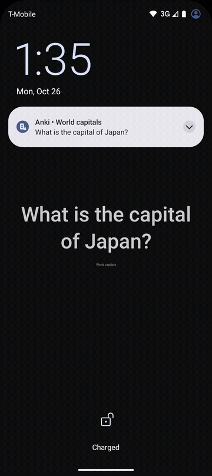
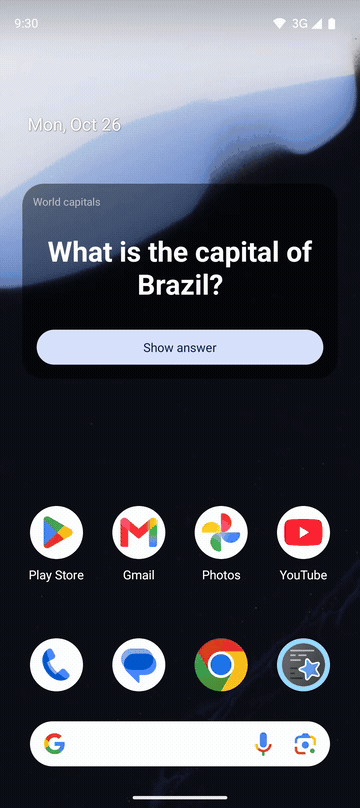
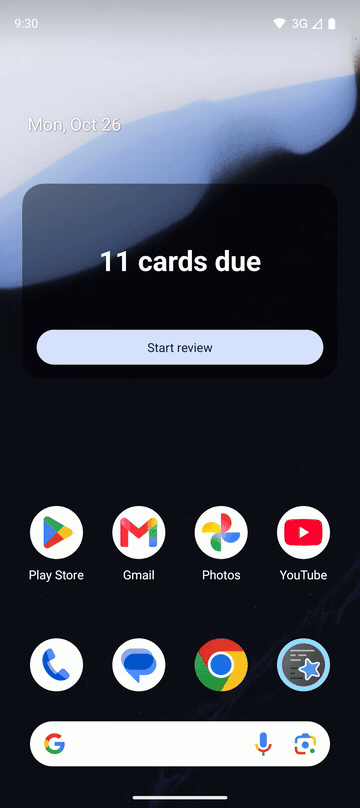

# Micro Review for AnkiDroid

Micro Review for AnkiDroid is an extension app for the AnkiDroid flashcard app. It lets you review your cards a few seconds at a time, from a notification, your lock screen or a home screen widget, without opening AnkiDroid.

| Lock screen | Notification | Widget |
|:---:|:---:|:---:|
|  |  |  |

## Features

### Where you review

- **Notification**: the current card's question is shown in a notification. Tap **Show answer** to see the answer and the Again / Hard / Good / Easy buttons. Only the buttons a card actually has are shown. The notification is fully visible on the lock screen, so you can answer without unlocking.

- **Lock screen card**: set the "Micro Review for AnkiDroid" live wallpaper on your lock screen, and the card to review is shown there. Your home screen wallpaper is not changed. Where a live wallpaper can't be set on the lock screen alone (before Android 14, or on some phones such as Honor's MagicOS), the app sets a **picture of the card** as your lock screen wallpaper instead, and changes it with each card. In **Settings**, choose whether it shows the question only, or the question and the answer (the notification then shows the answer buttons right away).

- **Open after unlock**: instead of the notification, a review screen can open when you unlock your phone, with the card already on the lock screen (Settings › **How to review**). Android only allows it with the "Display over other apps" permission, which Settings asks for; until then, the notification is used.

- **Home screen widget**: add the **Card** widget to your home screen and tap **Start review** to review the current card there: **Show answer**, then the answer buttons. Each answer shows the next card right away (it doesn't use up the lock screen's card). The widget goes back to **Start review** after 2 minutes without a tap, or when the screen turns off (with the lock screen wallpaper set).

- **Reviews at set times**: choose times of day in Settings, and at each one a notification offers the current card: "Time for a card", then **Start** to see the question. It can come a few minutes late, as Android groups alarms to save battery.

### How cards come

- **Several decks, in your order**: select the decks to review in the deck tree and put them in order. Cards come from the first deck that has a card to review, then the next one, and so on. A deck includes its subdecks.

- **One card per unlock**: with the lock screen wallpaper set, the card notification is only visible while the phone is locked: it is removed at every unlock and comes back at the next lock. After you answer, "Next card at your next unlock" is shown for a few seconds: one card each time you unlock, as a small habit. Turn on **Review several cards in a row** in Settings to get the next card right away instead. Without the wallpaper, the notification stays visible and cards follow each other.

- **Change the card at every unlock** (optional): if you unlock without answering, another due card comes at the next lock, rotating through the first due cards of your decks (how many is up to you). Skipped cards stay due in AnkiDroid, and after an answer the first card comes back.

- **Cards with sound are skipped**: cards whose question plays a sound can't be reviewed without opening AnkiDroid, so they are skipped. They stay due in AnkiDroid: nothing is recorded until you answer a card.

- **Always up to date**: the app re-checks the card against AnkiDroid when you open the app, when you lock the phone and every hour, and the notification comes back after a restart or once swiped away. After "Bravo!", new cards are picked up as they become due.

### Look and setup

- **Lock screen style**: choose a background color or image, the text color and the text size, with a live preview. On a picture, choose how it is filtered so the text stays readable (darken, lighten, blur, gradient behind the text, text panel or none) and how strongly.
- **Widget style**: the home screen widget has its own style, edited the same way: a background color, a picture (darkened, lightened or blurred), or see-through, showing the home screen wallpaper (darkened or lightened), and the text color.

- **Setup checklist**: the main screen lists anything still missing (notifications, lock screen wallpaper, background activity restricted by the battery settings) and how to fix it.

- **Report an issue**: Settings › Help opens a new GitHub issue with your phone model, Android version and app versions already filled in. You can check and edit everything before sending it.

- **Seamless integration**: the app doesn't store your decks, cards or reviews. Everything happens in your AnkiDroid app, through its official API, and each answer is recorded there with the time you spent on the card, as if you had reviewed it in AnkiDroid.

## Getting Started

1. **Install AnkiDroid** and make sure its API is enabled (AnkiDroid: Settings › Advanced › Enable AnkiDroid API).

2. **Install Micro Review for AnkiDroid** from the [releases](../../releases) page.

3. **Open the app and grant access**: allow access to your AnkiDroid cards and allow notifications. The "Finish setting up" checklist on the main screen shows anything still missing.

4. **Choose your decks**: tick decks in **All decks**, then order them under **Review order** with the arrows. Reviewing starts as soon as a deck is ticked: the first card shows up in a notification. Untick every deck to stop.

5. **Optional, lock screen**: tap **Set lock screen wallpaper** and follow the instructions to choose Micro Review for AnkiDroid for the **lock screen only**. Where that isn't possible (Android 8 to 13, some phones), the app offers to set a picture of the card on the lock screen instead: it replaces your current lock screen picture. In **Settings** (gear icon), choose what the lock screen shows, change its look, and choose how to review (notification or review screen after unlock).

6. **When you're done**: when no selected deck has a card left, you'll see "Bravo! You've finished all cards in the selected decks." A new notification comes when it's time to study again.

## Limitations

- **Simple cards only**: cards are shown as plain text. Images aren't shown, and cards with sound in the question are skipped.

- **Changes made in AnkiDroid**: AnkiDroid doesn't notify other apps. The app checks the displayed card when you open it, when you lock the phone (at most every 10 minutes), after a restart and every hour, and never answers a card that is no longer due.

- **Lock screen wallpaper**: a lock-screen-only live wallpaper needs Android 14 or newer with a lock screen wallpaper picker; elsewhere the card is a picture. With the picture, one card per unlock, "Change the card at every unlock" and "Open after unlock" aren't available (they need the live wallpaper's lock and unlock events), and lock screen features that change the picture by themselves (Magazine unlock, Glance) must be turned off.

## Development

- Build: `./gradlew assembleDebug` (JDK 17 or newer). Full check (lint and unit tests): `./gradlew build`.
- On Windows, `scripts/install.ps1` builds, installs and starts the app on a connected device (also available as the default build task in VS Code).
- Device tests: `scripts/device-tests.ps1` runs end-to-end scenarios with a fake AnkiDroid (`app/src/androidTest`), on an emulator by default (VS Code task "Android: run device tests"). They also run on an emulator for each pull request and before each release.
- Release: `scripts/release.ps1` runs the build, unit tests and device tests, then starts the Release workflow.
- See `CLAUDE.md` for the architecture.

## Contributing

Contributions to Micro Review for AnkiDroid are welcome! If you have any ideas, feature requests, or bug reports, please feel free to open an issue or submit a pull request on GitHub.

## License

This project is licensed under the MIT License (see [LICENSE](LICENSE)).

It includes the AnkiDroid API library (`com.github.ankidroid:Anki-Android`), licensed under the
[GNU LGPL v3](https://github.com/ankidroid/Anki-Android/blob/main/api/COPYING.LESSER).
